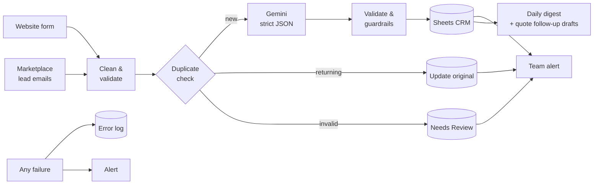

# LeadFlow — case study

**AI lead intake, qualification and follow-up automation for service businesses, built with n8n.**

> Every enquiry captured, cleaned, qualified by AI and followed up — without a single lead slipping through.

*Source code is kept in a private repository. A live walkthrough and full source are available to clients on request.*

---

## The problem

Small service businesses — contractors, clinics, agencies — lose jobs in the gap between "enquiry arrives" and "someone replies":

- Leads arrive in several places (website, Angi / Thumbtack / Yelp emails) and get missed.
- The same customer enquires twice and two people call them.
- Staff waste time on spam and out-of-area requests.
- Quotes go out and nobody follows up.

## The solution

Three n8n workflows working together, with Google Sheets as a zero-cost CRM:



| Workflow | What it does |
|---|---|
| **1. Lead intake & AI qualification** | Captures leads from a web form and parses marketplace notification emails; normalises emails and phone numbers; detects duplicates; asks Gemini for a category, 0–100 score, urgency, missing info and a reply draft; saves to the CRM and alerts the team |
| **2. Error handler** | Any failure in the other workflows is logged and emailed, so nothing fails silently |
| **3. Daily follow-ups** | Weekday 08:00 digest of follow-ups due, per owner; quotes unanswered for 3+ days get a personalised Gmail draft |

## How a lead moves through it

1. **Arrives** from the website form, a lead-site email in Gmail, or the built-in test mode.
2. **Cleaned and checked.** Emails are lowercased, phones converted to international format; a lead with no usable contact goes to *Needs Review*.
3. **Duplicate check.** A returning customer updates their existing row (repeat count + note) instead of creating a new one.
4. **Assigned** to a team member in turn (round-robin).
5. **Judged by AI.** Gemini returns a category, a 0–100 score, urgency, a reason, missing info and a reply draft.
6. **Checked again.** If the AI fails or contradicts itself, the lead goes to *Needs review*. It is never lost or silently discarded.
7. **Saved and alerted.** One row per lead in the CRM; the team gets an email for every lead worth their time.
8. **A human replies.** The draft sits in the sheet to be reviewed and sent. Nothing reaches a customer automatically.

## Results from a real test run

Seven realistic sample leads, run end-to-end through the live workflow with Gemini:

| Lead | Result | Score | Why |
|---|---|---|---|
| Jennifer Walsh — kitchen remodel | ✅ Qualified | 95 | Clear job inside the service area |
| Marcus Lee — drywall repair (Angi) | ✅ Qualified | 90 | Clear, urgent job |
| Sarah Kim — vague enquiry | 🟡 Needs review | 30 | Vague message, no location |
| Robert Diaz — deck repair | ⚪ Not a fit | — | Outside the service area |
| Growth Agency — SEO pitch | ⚪ Not a fit | — | Spam sales pitch |
| Jen Walsh — second message | 🔁 Merged | — | Same person as Jennifer: saved once, repeat noted |
| Tom — broken email & phone | 🟡 Needs Review tab | — | Stopped by validation before reaching the AI |

Every lead ended up in exactly the right place: two hot leads alerted, one flagged for a human, spam and out-of-area requests filed quietly, the duplicate merged, and the broken lead caught.

## Engineering highlights

- **The AI never decides alone.** Output must match a JSON schema; API errors, invalid JSON or contradictory answers (e.g. "Qualified" with a score of 20) fall back to *Needs review* so a real customer is never silently discarded.
- **Privacy-aware prompt.** The model is told *whether* an email or phone exists, never the actual values.
- **Idempotent.** Rows are upserted on a dedupe key, so re-runs never create duplicates; repeat enquiries are merged into the original lead with a note.
- **Human in the loop.** Nothing is emailed to customers automatically; replies and quote follow-ups are drafts for a person to approve.
- **Built to be handed over.** One Config node per workflow, a sample-data test mode with 7 realistic leads covering every branch, retries on every external call, and a setup guide.
- **Tested.** 21 automated tests run the workflows' real Code-node JavaScript outside n8n (no API keys needed) — normalisation, email parsing, deduplication, every AI failure mode, digest ordering and follow-up selection.

```
# tests 21
# pass 21
# fail 0
```

## Tech stack

n8n · Google Gemini API (structured output) · Google Sheets · Gmail · JavaScript · Node.js test runner · Docker

## Adaptable to

Any business that receives enquiries: home services, clinics, law firms, real-estate agents, agencies, coaches. Swapping Sheets for HubSpot / Pipedrive, or adding WhatsApp / Slack alerts, is a small change.

---

> **No lead is lost, every lead is answered fast, and nothing is sent without your approval.**

**Need something like this for your business?** → [Hire me on Freelancer](https://www.freelancer.pk/u/tayyabm03)
